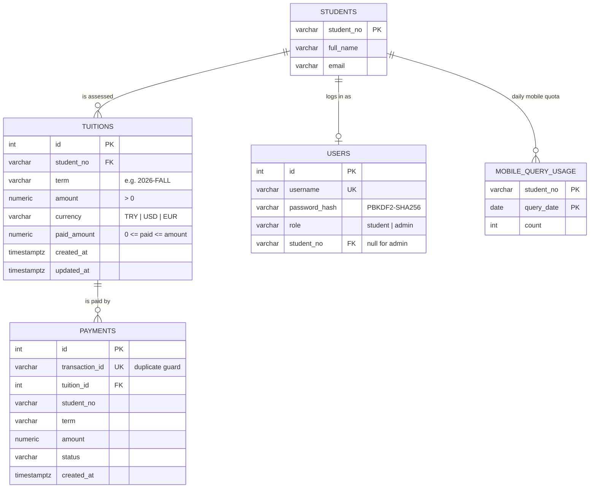

# ER / Data Model

Constraints:
- `UNIQUE(student_no, term)` on `tuitions`: one assessment per student per term (Add Tuition upserts).
- `UNIQUE(transaction_id)` on `payments`: rejects duplicate payments, even under concurrent requests.
- `CHECK(paid_amount <= amount)`: the database itself prevents overpayment.
- Balance = `amount - paid_amount` (derived, not stored).
- `mobile_query_usage` counts mobile queries per **student and day** (atomic `INSERT … ON CONFLICT DO UPDATE`).
